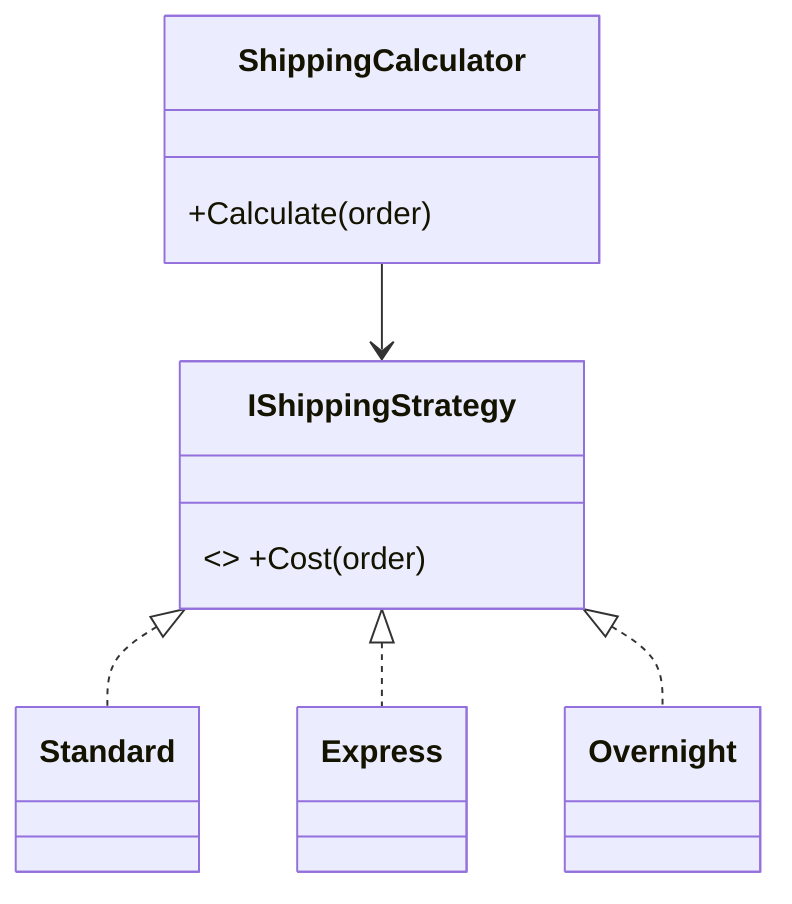

# Strategy

**Category:** Behavioral

## Intent
Define a family of interchangeable algorithms behind a common interface so the caller can swap them without changing.

## Smells / symptoms that suggest it
- A `switch`/`if` on a "type" or "mode" string that keeps growing.
- The same branching logic repeated in multiple methods.
- Adding a new variant means editing a class that already works.

## Structure

## Principles it serves
- Open/Closed - add a new strategy without modifying the calculator.
- Single Responsibility - each algorithm lives in its own place.
- Composition over Inheritance.

## When NOT to use it
- Two stable branches that never change - an `if` is clearer.
- In languages with first-class functions, a plain function/delegate is often enough (see the TypeScript example).

## Look-alikes and how to tell them apart
| Pattern | Difference |
|---|---|
| State | The object changes its own strategy as its state changes; with Strategy the *client* picks. |
| Template Method | Varies steps via inheritance; Strategy varies the whole algorithm via composition. |

## Real-world sightings
- `IComparer<T>` in .NET, `Array.prototype.sort(compareFn)` in JS.

## Examples
- C#: [`csharp/Before.cs`](csharp/Before.cs) → [`csharp/After.cs`](csharp/After.cs)
- TypeScript: [`typescript/before.ts`](typescript/before.ts) → [`typescript/after.ts`](typescript/after.ts)

## My takeaways
<!-- Fill this in yourself! -->
